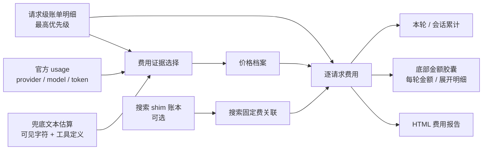

# dsh-billing-stats

> **订阅账号也适用的 DSH 等价 API 计费统计。**
>
> 不调用 LLM，不修改请求。优先用官方 usage 或请求级账单明细计价；两者都没有时，
> 才按可见文本做透明的兜底估算，并始终标注费用来源。

`dsh-billing-stats` 是 DSH 的只读计费统计插件。它适合想知道“这顿操作值多少钱”的人，
也适合用订阅或中转方式间接调用模型、但看不到逐次 API 账单的人。

当前内置价格档案仅覆盖 **DeepSeek 系列模型**，并已在 DSH `0.2.0-rc.2` 的 web profile
中完成真实功能验收。

## 先回答三个问题

### 1. 这次请求花了多少？

展开金额胶囊可以看到未缓存输入、缓存读取、缓存写入、输出（含 reasoning）、搜索固定费和
未知项，不再只有一个模糊的 token 总数。

### 2. 这一轮、这个会话一共花了多少？

底部原生用量区域显示会话累计金额；每轮完成后显示本轮金额和时间。金额会随 usage 增量
更新，不需要等账单出来才看得到。

### 3. 订阅或中转用户，怎么知道“值不值”？

插件同时保留两种口径：

| 口径 | 含义 | 适合回答 |
|---|---|---|
| 公开价 | 按公开 API 单价推算的等价金额 | 如果这些 token 直接走 API，大概要花多少？ |
| 账单口径 | 用导入账单校准后的金额估计 | 我的账户/套餐实际按什么倍率扣费？ |

订阅用户可以用“公开价”观察同样用量对应的 API 价值；API 用户可以用“账单口径”把
公开价和实际扣款对齐。账单口径是本地估计，不是供应商发票。

## 四类用户，四种心理账

同样消耗一笔 token，不同计费方式的人关注的并不是同一个数字。

| 你的使用方式 | 你真正关心的问题 | 插件现在能回答什么 |
|---|---|---|
| 官方 API | 这次请求、今天、这个项目到底扣了多少钱？ | 逐请求金额、逐轮/会话汇总、账单导入与账户倍率拟合 |
| 订阅账号 | 月费有没有用回来？这些使用量换成 API 值多少钱？ | 公开价等价金额、实时累计、会话与轮次对比 |
| 中转 API | 所谓折扣是真的便宜，还是只是换了计费方式？ | 公开价与账单口径并列；可导入中转账单校准 |
| 自部署 | GPU、电力、运维摊到每百万 token 是多少？ | **暂不覆盖**；当前不是 GPU/TCO 计费器 |

插件不把“高 token 消耗”直接解释成高价值。它只负责把用量算清楚，价值判断留给你。

## 数据怎么流动



插件只读取 DSH 已经产生的事件和本地账本：

- 不修改 `low / high / max` 思考档位；
- 不修改 `maxTokens`；
- 不阻断请求或工具调用；
- 不调用 LLM，不需要联网；
- 费用来源固定按 `账单明细 > 官方用量 > 文本估算 > 未知` 选择；
- 文本估算不会伪装成官方 token 用量；
- 不把未知 token 按 0 元计算。

## 核心能力

- **逐请求统计**：输入、缓存读取、缓存写入、输出和搜索费用分项展示。
- **逐轮与会话累计**：贴合 DSH 原生用量区域，不另做一套割裂的 dashboard。
- **公开价 + 账单口径**：既能看等价 API 价值，也能用真实账单校准。
- **价格档案切换**：内置 DeepSeek 官方 API 与 OpenCode Go 两套配置。
- **账单拟合**：导入 CSV / JSON / JSONL；先拟合账户倍率，样本足够时再拟合分桶单价。
- **搜索归因**：按请求体指纹和 FIFO 关联搜索账本，固定费进入单独分项。
- **本地可追溯**：usage ledger、搜索状态和拟合结果都保存在本地 JSONL / JSON 文件。
- **可分享报告**：生成离线 HTML 费用说明，不需要把数据上传到第三方。

## 界面

- DSH 会话底部显示“会话费用 ¥金额”胶囊；
- 每轮完成后显示“用量 ¥金额 + 时间”；
- 点击金额可查看本轮与最近请求的 token、单价和费用拆分；
- 搜索请求显示次数与固定费；
- 命令结果作为持久化 flow 节点保留在会话中。

## 安装

### npm

```powershell
dsh plugin --profile web add dsh-billing-stats@0.1.0
```

### GitHub Release tarball

```powershell
dsh plugin --profile web add https://github.com/SSHOOTING/dsh-billing-stats/releases/download/v0.1.0/dsh-billing-stats-0.1.0.tgz
```

### 本地开发链接

```powershell
dsh plugin --profile web add link:E:/programs/dsh-billing-attribution
```

安装后确认 profile 的 `package.json` 已把 `dsh-billing-stats` 加入
`dsh.profile.bundles`，然后重启 DSH web 进程。只改客户端卡片时刷新页面即可；Host
代码变化后必须重启。

详细的安装、配置与回滚步骤见 [安装说明](install/README.md)。

## 配置

发布包自带的 `cordis.patch.yml` 使用可移植默认值，并默认关闭搜索账本关联。需要长期
保存账本或启用搜索时，在 profile 的 `cordis.patch.yml` 中覆盖：

```yaml
- id: billing-attribution
  config:
    displayCurrency: CNY
    ledgerPath: '<可写数据目录>/usage-ledger.jsonl'
    searchStatePath: '<可写数据目录>/search-state.json'
    billDetailPath: '<请求级账单明细 JSONL>'
    searchLedgerEnabled: true
    searchLedgerPath: '<搜索 shim 的 JSONL 路径>'
    activeProfile: auto
    maxRecentRequests: 20
```

`ledgerPath` 和 `searchStatePath` 应该放在用户可写、可备份的目录，不要依赖升级时会被
替换的包目录。搜索账本不存在时插件只跳过搜索关联，不影响模型计费。
`billDetailPath` 在 Host 启动时载入；导入或替换请求级账单明细后，需要重启 DSH Web
进程才会重新读取。

## 命令

```text
/cost                         查看本轮和会话累计
/cost explain                 查看最近一次请求的 token、单价和费用拆分
/cost profiles                查看价格档案
/cost profile auto            按 provider 自动选择价格档案
/cost profile opencode-go     切换到指定档案
```

档案切换只影响切换后的请求，历史请求不会用新档案重算。

## 已验证

2026-11-11 在 Windows、Node.js `v24.19.0`、DSH `0.2.0-rc.2` web profile 中实测：

| 项目 | 结果 |
|---|---|
| `npm test` | 24 / 24 通过 |
| `npm run check` | 18 个 JS/MJS 文件通过 |
| `/cost` | 成功显示账单口径、公开价、请求数和最近请求 |
| `/cost explain` | 成功显示 token、单价、峰时倍率和金额 |
| `/cost profiles` | 成功列出两套档案 |
| 档案切换 | 切换后新请求使用新档案，历史金额不变 |
| 原生金额 UI | 会话胶囊、每轮金额和搜索行均已验证 |
| 真实搜索关联 | ledger `settled`，搜索 1 次，固定费 `¥0.005` |
| HTML 报告 | 样例包含 35 条 usage、3 条账单，生成成功 |

## 已知边界

- 当前只内置 DeepSeek 系列模型价格；其他模型需要自备价格档案。
- `公开价` 是等价推算，不保证等于实际扣款；`账单口径` 也不是发票。
- 聚合账单只能可靠拟合总额倍率；没有请求级账单时，不能可靠拆分四个 token 桶。
- 固定汇率为 `1 USD = 7.2 CNY`，换汇率后历史结果不会自动回写。
- 峰时窗口按北京时间工作日配置，不内置法定节假日日历。
- 搜索关联是 best-effort；缺少精确 request id 时存在错配可能。
- 官方 usage 缺失时会按可见文本和工具定义折算 token；该金额会标注为“文本估算”，
  不等于供应商最终账单。
- 负金额、退款、赠送额度和跨账单冲销不在 v0.1.0 范围内。
- 不计算自部署 GPU、电力和运维成本。

## 开发与验证

```powershell
npm test
npm run check
npm run bill:import -- --bill .\examples\bill.sample.csv --out .\data\bill.normalized.jsonl
npm run bill:fit -- --usage .\examples\usage.sample.jsonl --bill .\data\bill.normalized.jsonl --profile deepseek-official --out .\pricing\fitted\deepseek-official.json
npm run report -- --bill .\examples\bill.sample.csv --out .\reports\billing-explainer.html
```

## 更多文档

- [安装与回滚说明](install/README.md)
- [计费模型与实验边界](docs/BILLING-MODEL.md)
- [账单格式与拟合方法](docs/BILL-FITTING.md)
- [可视化计费说明](docs/billing-explainer.html)
- [变更记录](CHANGELOG.md)

## License

[MIT](LICENSE) © 2026 dsh-billing-stats contributors
